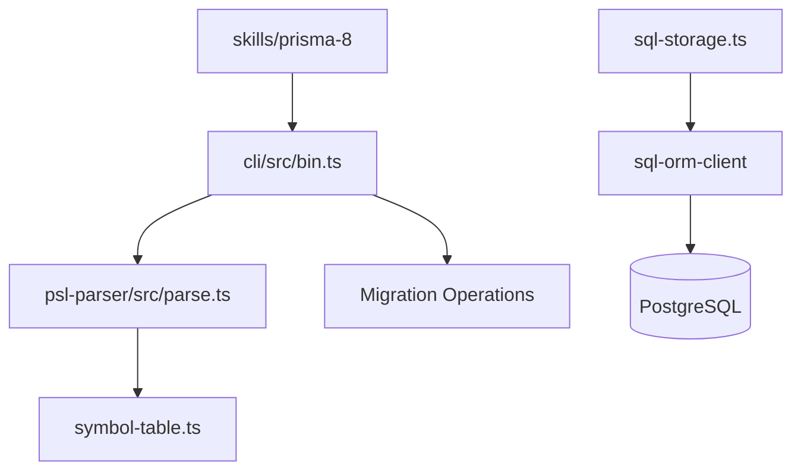

# prisma/orm

> ORM TypeScript Prisma 8 (version candidate), même dépôt que prisma/prisma sous un autre nom.

## Le problème
Écrire l'accès aux bases à la main produit du code répétitif, peu typé et difficile à faire évoluer.

## Ce que ça fait vraiment
Identité et README identiques à prisma/prisma (mêmes étoiles, mêmes dates, 2 841 issues) : c'est le même dépôt, listé sous deux noms. Le contrat PSL est analysé, validé, converti en stockage SQL ou Mongo, puis le client ORM exécute les requêtes. S'y ajoutent CLI, serveur de langage, migrations et skills d'agents.

## Comment c'est branché


## Essayer
```bash
npm create prisma
npx prisma orm init
npx prisma skills sync
```

## Coût et pièges
Node.js 24 ou plus. Version candidate avec ruptures possibles. Télémétrie du CLI visible dans le graphe (`sender.ts` vers `handler.ts`).

## Ce que ce n'est pas
Pas un second projet : doublon de prisma/prisma. Pas stable tant que `8.0.0` n'est pas publié.

## Alternatives
Aucune alternative nommée dans le README.

## Pour toi
Même verdict que prisma/prisma, à ne traiter qu'une fois : surveille la sortie finale avant d'en dépendre.

