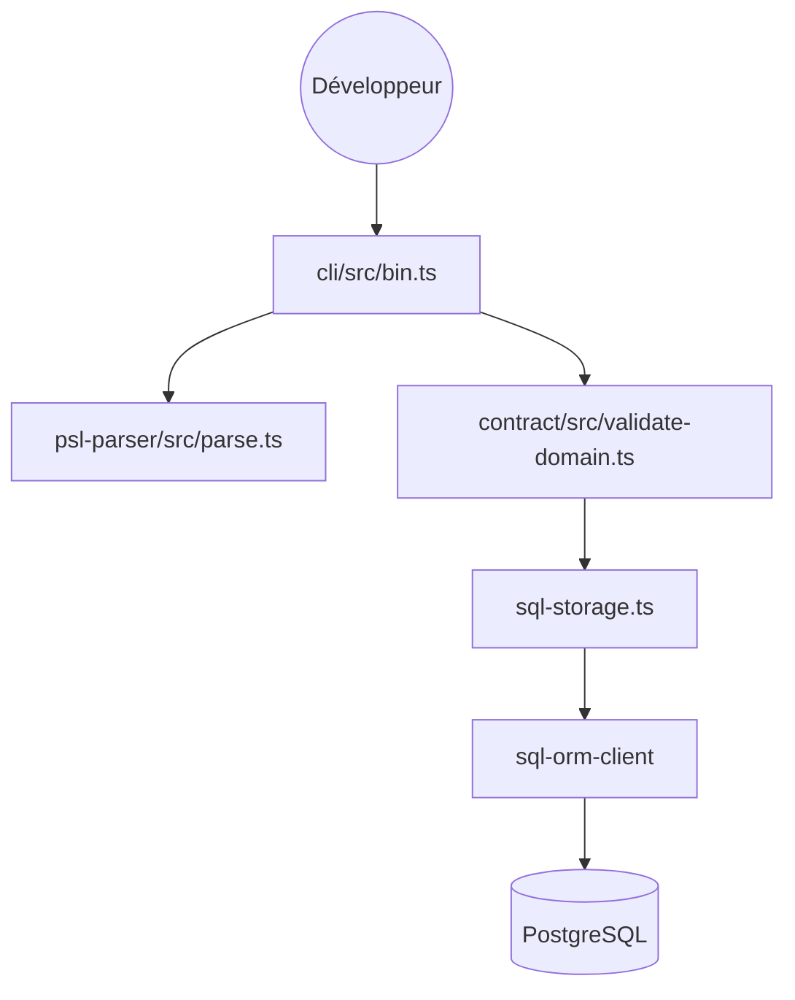

# prisma/prisma

> ORM TypeScript Prisma 8 (candidate version): PSL contract, typed PostgreSQL or MongoDB queries.

## The problem
Writing access to databases by hand results in repetitive, poorly structured code that is difficult to maintain and update.

## What it actually does
Rewriting Prisma in TypeScript, with extensibility. A PSL contract is analyzed, validated, and converted into a SQL or MongoDB storage representation, after which the client ORM executes the queries. It provides a CLI, a language server, migrations, extensions (pgvector, PostGIS, ParadeDB, Supabase), and skills for agents. The README announces the final version `8.0.0` within four to eight weeks, with the possibility of breaking changes before then. The content of this repository and prisma/orm is identical.

## How it is wired


## Trying it
```bash
npm create prisma
npx prisma orm init
npx prisma skills sync
```

## Cost and gotchas
Node.js version 24 or later. Candidate version: breaking changes may occur. The graph shows telemetry from the command-line interface (CLI) to a project server.

## What it is not
Not stable (RC) and not Prisma 7, maintained on the `v7` branch. Only PostgreSQL and MongoDB are mentioned.

## Alternatives
No alternative is specified in the README file.

## For you
Relevant for data services in TypeScript, using pgvector for AI; monitor up to version `8.0.0` before relying on it.
