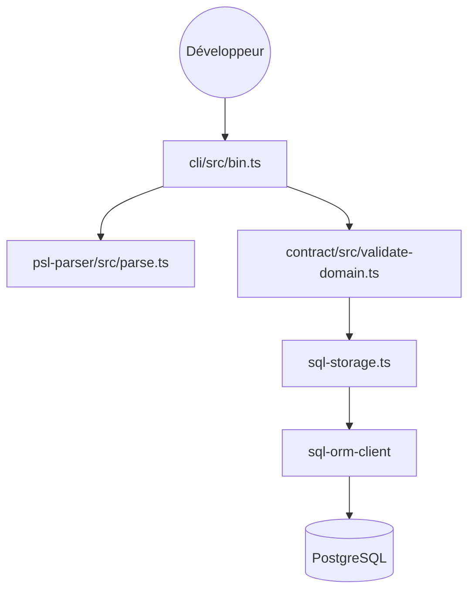

# prisma/prisma

> ORM TypeScript Prisma 8 (version candidate) : contrat PSL, requêtes typées PostgreSQL ou MongoDB.

## Le problème
Écrire l'accès aux bases à la main produit du code répétitif, peu typé et difficile à faire évoluer.

## Ce que ça fait vraiment
Réécriture de Prisma en TypeScript, extensible. Un contrat PSL est analysé, validé, converti en représentation de stockage SQL ou Mongo, puis le client ORM exécute les requêtes. Il fournit CLI, serveur de langage, migrations, extensions (pgvector, PostGIS, ParadeDB, Supabase) et skills pour agents. Le README annonce `8.0.0` final sous quatre à huit semaines et des ruptures possibles d'ici là. Les contenus de ce dépôt et de prisma/orm sont identiques.

## Comment c'est branché


## Essayer
```bash
npm create prisma
npx prisma orm init
npx prisma skills sync
```

## Coût et pièges
Node.js 24 ou plus. Version candidate : des ruptures sont possibles. Le graphe montre une télémétrie du CLI vers un serveur du projet.

## Ce que ce n'est pas
Pas stable (RC) et pas Prisma 7, maintenu sur la branche `v7`. Seuls PostgreSQL et MongoDB sont cités.

## Alternatives
Aucune alternative nommée dans le README.

## Pour toi
Pertinent pour les services de données en TypeScript, avec pgvector pour l'IA ; surveille jusqu'à `8.0.0` final avant d'en dépendre.

