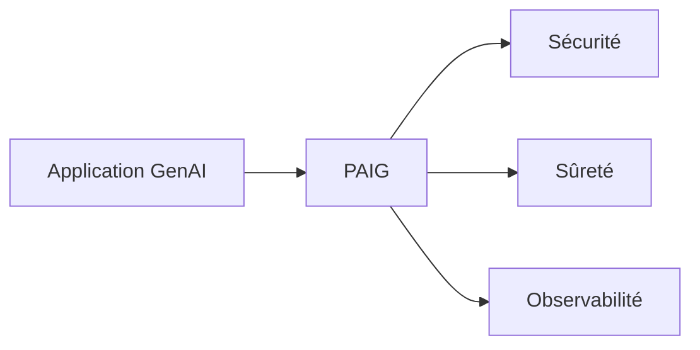

# privacera/paig

> Open project for protecting generative AI applications: security, safety and observability.

## The problem
Generative AI applications evolve fast and their security risks call for protections that must be integrated without rewriting the application.

## What it actually does
The very short README announces a framework to secure, make safe and observe GenAI applications, with integration of point solutions. Details (features, architecture) point to the external website and documentation: not documented here.

## How it is wired
Not documented in the README.

Simplified diagram based on the sheet, no diagram provided.

## Trying it
No documented command. The README offers a Google Colab notebook or a Jupyter notebook to download.

## Cost and gotchas
Free according to the README. The last push dates from August 2025, more than a year ago. Much has to be looked up in the external documentation.

## What it is not
Not demonstrated by the README: no specific feature or guarantee appears in it. Not a ready-to-plug product on the strength of this page alone.

## Alternatives
None named in the README.

## For you
The topic (securing LLM applications) concerns you, but the repository has been silent for over a year and the README is empty: watch.
