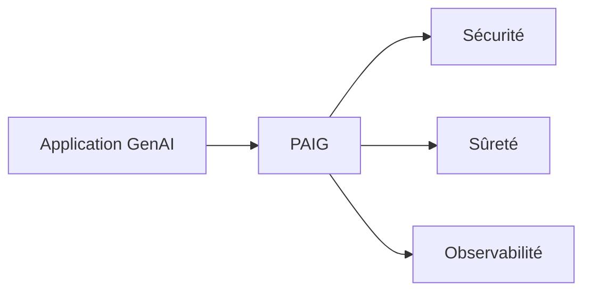

# privacera/paig

> Projet ouvert de protection des applications d'IA générative : sécurité, sûreté et observabilité.

## Le problème
Les applications d'IA générative évoluent vite et leurs risques de sécurité exigent des protections qu'il faut intégrer sans réécrire l'application.

## Ce que ça fait vraiment
Le README, très court, annonce un cadre pour sécuriser, rendre sûres et observer les applications GenAI, avec intégration de solutions ponctuelles. Les détails (fonctions, architecture) renvoient au site et à la documentation externes : non documenté ici.

## Comment c'est branché
Non documenté dans le README.

Schéma simplifié d'après la fiche, sans diagramme fourni.

## Essayer
Aucune commande documentée. Le README propose un notebook Google Colab ou un notebook Jupyter à télécharger.

## Coût et pièges
Gratuit d'après le README. Le dernier push date d'août 2025, soit plus d'un an. Beaucoup de choses sont à chercher dans la documentation externe.

## Ce que ce n'est pas
Ce n'est pas démontré par le README : aucune fonction précise ni garantie n'y figure. Pas un produit prêt à brancher sur la foi de cette seule page.

## Alternatives
Aucune nommée dans le README.

## Pour toi
Le sujet (sécuriser les applications LLM) te concerne, mais le dépôt est silencieux depuis plus d'un an et le README est vide : à surveiller.

