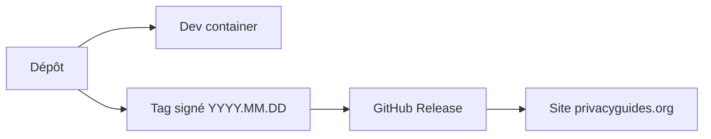

# privacyguides/privacyguides.org

> Volunteer collective website recommending tools to protect digital privacy, aimed at the general public.

## The problem
Choosing privacy-respecting tools amid marketing noise is hard, and guides are often tied to vendors.

## What it actually does
It is the source code of the privacyguides.org site: a non-profit collective, with no advertising and no affiliation with the vendors listed. The README only describes the site: mirrors (GitHub Pages, BunnyCDN, Tor/onion), local build and publishing. The content of the recommendations is not detailed in the README.

## How it is wired


## Trying it
```bash
git config commit.gpgsign true
git tag -s YYYY.MM.DD -m 'Some message'
git push --tags
```

## Cost and gotchas
Free. Local builds are only supported through a dev container (Docker, VS Code, Dev Containers). Commits must be signed.

## What it is not
It is not software to install: it is a content site. It is not a security audit, and the README does not describe the selection method.

## Alternatives
No alternative named in the README.

## For you
Keep an eye on it: useful as a reference for choosing privacy tools, but with no direct link to your data/AI code.
