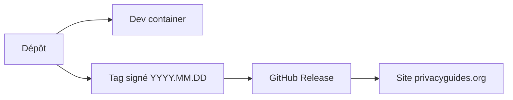

# privacyguides/privacyguides.org

> Site collectif bénévole qui recommande des outils pour protéger sa vie privée numérique, pour le grand public.

## Le problème
Choisir des outils respectueux de la vie privée au milieu du marketing est difficile, et les guides sont souvent liés à des fournisseurs.

## Ce que ça fait vraiment
C'est le code source du site privacyguides.org : un collectif à but non lucratif, sans publicité, sans affiliation aux fournisseurs listés. Le README ne décrit que le site : miroirs (GitHub Pages, BunnyCDN, Tor/onion), compilation locale et publication. Le contenu des recommandations n'est pas détaillé dans le README.

## Comment c'est branché


## Essayer
```bash
git config commit.gpgsign true
git tag -s YYYY.MM.DD -m 'Some message'
git push --tags
```

## Coût et pièges
Gratuit. La compilation locale n'est supportée que via dev container (Docker, VS Code, Dev Containers). Les commits doivent être signés.

## Ce que ce n'est pas
Ce n'est pas un logiciel à installer : c'est un site de contenu. Ce n'est pas un audit de sécurité, et le README ne décrit pas la méthode de sélection.

## Alternatives
Aucune alternative nommée dans le README.

## Pour toi
Surveiller : utile comme référence pour choisir des outils de confidentialité, mais sans lien direct avec ton code data/IA.

