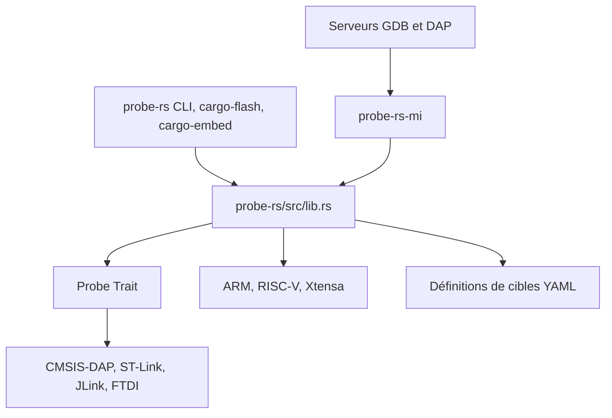

# probe-rs/probe-rs

> Rust toolbox for debugging and flashing microcontrollers through USB debug probes.

## The problem
Flashing and debugging ARM, RISC-V or Xtensa microcontrollers requires one tool per probe and per chip, often proprietary.

## What it actually does
Talks to DAPLink, ST-Link, J-Link, FTDI, ESP32 USB JTAG, WLink and Blackmagic probes. It reads and writes memory, controls cores (halt, step, breakpoints) and downloads ELF, BIN and IHEX binaries with CMSIS-Pack flash algorithms. Tools provided: `probe-rs run`, cargo-flash, cargo-embed, GDB and DAP servers (VS Code). A Linux host can serve as an SWD probe through GPIO or spidev.

## How it is wired


## Trying it
```bash
probe-rs run --chip nRF52840_xxAA
cargo run
probe-rs info --probe 0:0:/dev/spidev0.0
```
For `cargo run`, configure the runner in `.cargo/config.toml`.

## Cost and gotchas
Free, but a hardware probe is needed (outside the list of prerequisites) and, to compile, Rust and Cargo. cargo-embed is to be abandoned eventually; prefer `probe-rs run`.

## What it is not
Not a hardware attack tool: it is an embedded development tool. STM32 memory region data have been unreliable and are regenerated separately.

## Alternatives
No alternative cited in the README; cargo-embed and cargo-flash are tools from the same repository.

## For you
Ignore: embedded firmware tooling, only useful if you deploy AI on a microcontroller.
