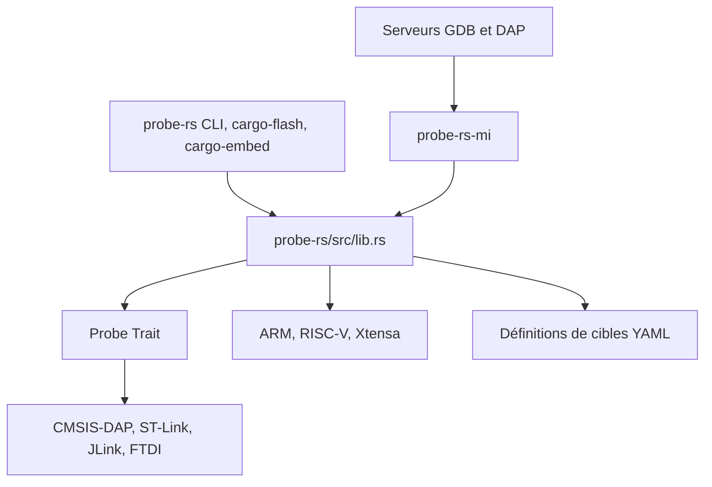

# probe-rs/probe-rs

> Boîte à outils Rust de débogage et de flashage de microcontrôleurs via des sondes de débogage USB.

## Le problème
Flasher et déboguer des microcontrôleurs ARM, RISC-V ou Xtensa exige un outil par sonde et par puce, souvent propriétaire.

## Ce que ça fait vraiment
Parle à des sondes DAPLink, ST-Link, J-Link, FTDI, ESP32 USB JTAG, WLink et Blackmagic. Elle lit et écrit la mémoire, contrôle les cœurs (arrêt, pas, points d'arrêt) et télécharge des binaires ELF, BIN et IHEX avec les algorithmes de flash CMSIS-Pack. Outils fournis : `probe-rs run`, cargo-flash, cargo-embed, serveurs GDB et DAP (VS Code). Un hôte Linux peut servir de sonde SWD par GPIO ou spidev.

## Comment c'est branché


## Essayer
```bash
probe-rs run --chip nRF52840_xxAA
cargo run
probe-rs info --probe 0:0:/dev/spidev0.0
```
Pour `cargo run`, configurer le runner dans `.cargo/config.toml`.

## Coût et pièges
Gratuit, mais une sonde matérielle est nécessaire (hors liste de prérequis) et, pour compiler, Rust et Cargo. cargo-embed doit être abandonné à terme ; préférer `probe-rs run`.

## Ce que ce n'est pas
Pas un outil d'attaque matérielle : c'est un outil de développement embarqué. Les données de régions mémoire STM32 ont été peu fiables et se régénèrent à part.

## Alternatives
Aucune alternative citée dans le README ; cargo-embed et cargo-flash sont des outils du même dépôt.

## Pour toi
Ignorer : outillage de firmware embarqué, utile seulement si tu déploies de l'IA sur microcontrôleur.

