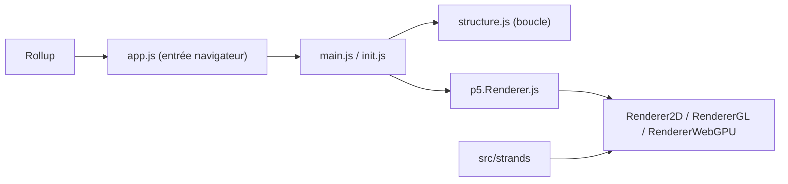

# processing/p5.js

> Accessible creative-coding JavaScript library, for artists, designers, teachers and beginners.

## The problem
Drawing and animating in a browser with plain JavaScript is laborious for non-specialists.

## What it actually does
Provides a `setup()`/`draw()` cycle and APIs for drawing, interaction, media, data, typography and accessibility, with Canvas 2D, WebGL and WebGPU rendering. A `p5.strands` subsystem translates a shader API into GLSL/WGSL. The project is backed by the Processing Foundation, with rotating leadership; it does not accept fully AI-generated contributions.

## How it is wired


## Trying it
```js
function setup() {
  createCanvas(400, 400);
  background(255);
}
function draw() {
  circle(mouseX, mouseY, 80);
}
```

## Cost and gotchas
Free. LGPL-2.1: obligations on modifications to the library. Maintained mostly by volunteers, response times vary.

## What it is not
It is not a data visualization library: it draws, with no notion of a statistical chart.

## Alternatives
No alternative named in the README (Processing is cited as an inspiration).

## For you
Keep an eye on it: useful for generative or educational visualizations, not for analytical dataviz.
