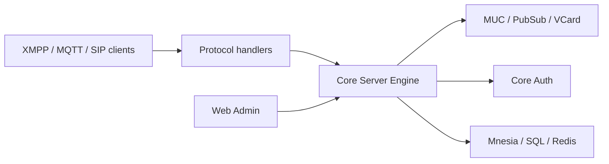

# processone/ejabberd

> Real-time XMPP, MQTT and SIP messaging server in Erlang/OTP, for messaging operators.

## The problem
Hosting your own scalable, extensible instant messaging.

## What it actually does
Erlang/OTP server: XMPP (C2S, S2S), MQTT broker, SIP service, modules (MUC, PubSub, vCard), web administration interface, multiple authentication methods (LDAP, SQL, PAM…), Mnesia or SQL storage, Redis, clustering. The README mentions ProcessOne's commercial offerings (Business Edition, Fluux). It declares GPL v2 although GitHub does not identify it.

## How it is wired


## Trying it
```bash
./configure --help
make help
ejabberdctl help
man ejabberd.yml
```

## Cost and gotchas
Installation from source, installers, or `ecs` or `ejabberd` containers. Paid commercial edition sold separately.

## What it is not
Not a turnkey team messaging tool.

## Alternatives
No alternative named in the README.

## For you
Ignore: messaging server unrelated to data/AI/MLOps.
