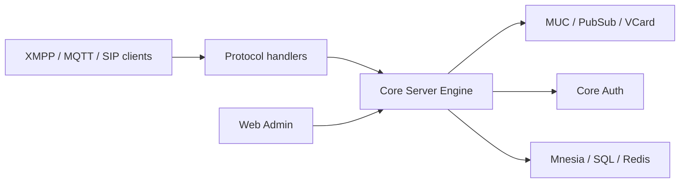

# processone/ejabberd

> Serveur de messagerie temps réel XMPP, MQTT et SIP en Erlang/OTP, pour opérateurs de messagerie.

## Le problème
Héberger sa propre messagerie instantanée scalable et extensible.

## Ce que ça fait vraiment
Serveur Erlang/OTP : XMPP (C2S, S2S), broker MQTT, service SIP, modules (MUC, PubSub, vCard), interface web d'administration, authentification multiple (LDAP, SQL, PAM…), stockage Mnesia ou SQL, Redis, cluster. Le README mentionne les offres commerciales ProcessOne (Business Edition, Fluux). Il déclare GPL v2 alors que GitHub ne l'identifie pas.

## Comment c'est branché


## Essayer
```bash
./configure --help
make help
ejabberdctl help
man ejabberd.yml
```

## Coût et pièges
Installation par sources, installeurs, conteneurs `ecs` ou `ejabberd`. Édition commerciale payante à part.

## Ce que ce n'est pas
Pas un outil de messagerie d'équipe clé en main.

## Alternatives
Aucune alternative nommée dans le README.

## Pour toi
À ignorer : serveur de messagerie sans lien avec data/IA/MLOps.

