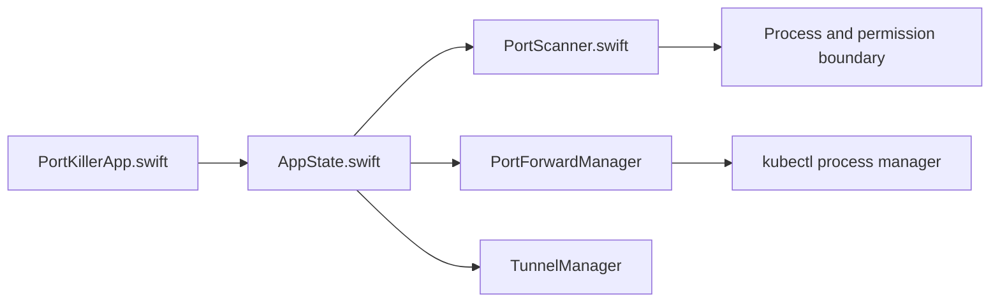

# productdevbook/port-killer

> Desktop application that lists listening TCP ports and kills processes, for developers.

## The problem
A forgotten dev server occupies a port and you have to find which process holds it. `kubectl port-forward` sessions that drop silently waste time.

## What it actually does
Discovers listening TCP ports, filters by number or process, stops a process (gentle or forced), manages favorites and watched ports with notifications. It also manages `kubectl port-forward` sessions with automatic reconnection and shows local `cloudflared` processes. Three independent implementations: Swift/SwiftUI (macOS), C#/WPF (Windows), Python (Linux), plus a Rust library. The Kubernetes subsystem is the most complete on macOS.

## How it is wired


## Trying it
```bash
brew install --cask productdevbook/tap/portkiller
```
Windows: download the `.zip` from the GitHub Releases.

## Cost and gotchas
Free, MIT. The Kubernetes features assume `kubectl` is installed; tunnels assume `cloudflared`. Linux installation: an `install.sh` script, poorly documented in the README.

## What it is not
Not a network scanner: it only looks at local ports. The three platforms share no interface code, so their features may differ.

## Alternatives
No alternative named in the README.

## For you
Adopt if you juggle port-forwards to ML clusters: free, lightweight, and the gesture it saves is a daily one.
