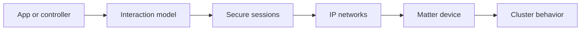

# project-chip/connectedhomeip

> Open source SDK for the Matter smart-home standard, for manufacturers and integrators of connected devices.

## The problem
Connected devices from different brands do not talk to each other; Matter defines a common IP protocol.

## What it actually does
Implements the Matter stack: security and sessions, message framing and routing, interaction model and data model, application clusters, Wi-Fi, Thread and BLE transports. Provides firmware examples, Python testing tools and IDL. Built with GN.

## How it is wired

## Trying it
No command documented in the README: it points to the build guide; the `gn_build.sh` script is mentioned.

## Cost and gotchas
Free, Apache-2.0. The applications in `examples/` are development references, not products. Large repository, complex build.

## What it is not
Not a home automation application: an SDK for firmware and controllers. It does not replace the Alliance's specification.

## Alternatives
No alternative named in the README.

## For you
Ignore: home automation and embedded IoT, unrelated to data/AI/MLOps.
