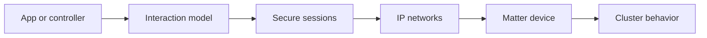

# project-chip/connectedhomeip

> SDK open source du standard domotique Matter, pour fabricants et intégrateurs d'objets connectés.

## Le problème
Les objets connectés de marques différentes ne communiquent pas ; Matter définit un protocole IP commun.

## Ce que ça fait vraiment
Implémente la pile Matter : sécurité et sessions, cadrage et routage des messages, modèle d'interaction et modèle de données, clusters applicatifs, transports Wi-Fi, Thread et BLE. Fournit exemples de firmware, outils Python de test et IDL. Construit avec GN.

## Comment c'est branché

## Essayer
Aucune commande documentée dans le README : il renvoie au guide de construction ; le script `gn_build.sh` est cité.

## Coût et pièges
Gratuit, Apache-2.0. Les applications de `examples/` sont des références de développement, pas des produits. Dépôt volumineux, build complexe.

## Ce que ce n'est pas
Pas une application domotique : un SDK pour firmware et contrôleurs. Il ne remplace pas la spécification de l'Alliance.

## Alternatives
Aucune alternative nommée dans le README.

## Pour toi
Ignorer : domotique et IoT embarqué, sans lien avec data/IA/MLOps.

