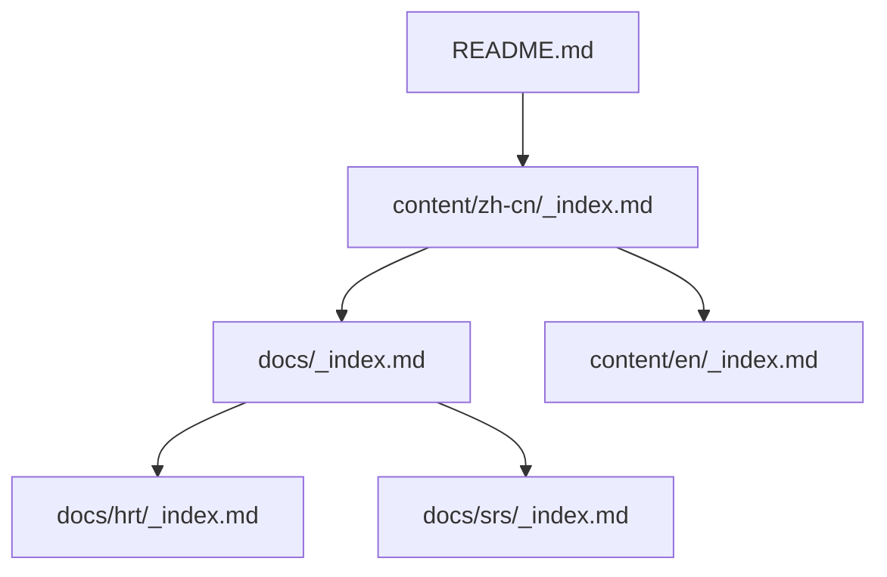

# project-trans/MtF-wiki

> Multilingual community wiki of medical and practical information on male-to-female transgender identity.

## The problem
Trans feminine people lack free, structured and up-to-date resources.

## What it actually does
A documentation site under the CC BY-SA 4.0 license, in Simplified Chinese (the most complete), Traditional Chinese, Japanese and English. Sections cover hormone therapy, medicine, gender-affirming surgery and psychology. The authors warn that the content is still incomplete and may contain errors.

## How it is wired

## Trying it
No documented command: visit the site mtf.wiki.

## Cost and gotchas
Free. Content to be read with caution; it does not replace medical advice.

## What it is not
Not a code repository: there is no application, only content.

## Alternatives
FtM.wiki, sister site cited at the top of the README.

## For you
Ignore: content unrelated to data / AI / MLOps work, but useful for the audience it targets.
