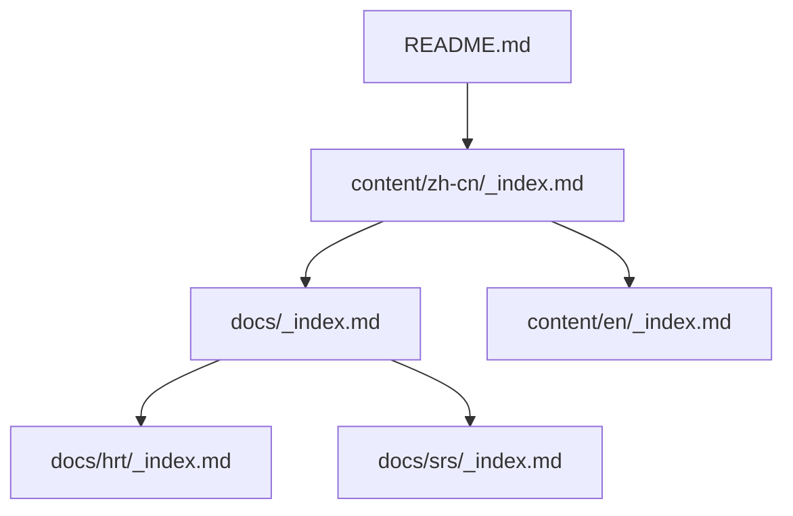

# project-trans/MtF-wiki

> Wiki communautaire multilingue d'informations médicales et pratiques sur la transidentité féminine.

## Le problème
Les personnes transféminines manquent de ressources libres, structurées et tenues à jour.

## Ce que ça fait vraiment
Un site documentaire sous licence CC BY-SA 4.0, en chinois simplifié (le plus complet), chinois traditionnel, japonais et anglais. Les sections couvrent le traitement hormonal, la médecine, la chirurgie de réassignation et la psychologie. Les auteurs préviennent que le contenu est encore incomplet et peut contenir des erreurs.

## Comment c'est branché

## Essayer
Aucune commande documentée : consulter le site mtf.wiki.

## Coût et pièges
Gratuit. Contenu à relire avec prudence, il ne remplace pas un avis médical.

## Ce que ce n'est pas
Pas un dépôt de code : il n'y a aucune application, seulement du contenu.

## Alternatives
FtM.wiki, site frère cité en tête du README.

## Pour toi
Ignorer : contenu sans rapport avec un travail data / IA / MLOps, mais utile pour le public auquel il s'adresse.

