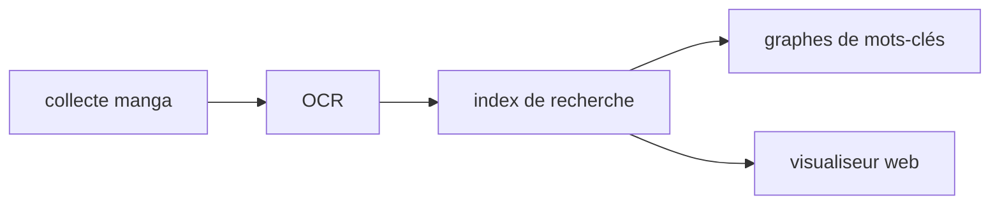

# project-violet/violet

> Personal toolbox for collecting manga, running OCR, indexing and serving a web viewer.

## The problem
Collecting manga content, indexing it and browsing it requires chaining several separate tools.

## What it actually does
The README announces manga content collection, OCR, search index building, keyword graph analysis and a web viewer. The Docker deployment goes through a `deploy.sh` script and data files to download from Google Drive. The rest is deferred to DOCKER.md, which was not provided.

## How it is wired

Simplified diagram based on the sheet, no diagram provided.

## Trying it
```bash
curl -fsSL https://raw.githubusercontent.com/project-violet/violet/main/deploy.sh | VIOLET_DATA_ROOT=/srv/violet-data sh
```

## Cost and gotchas
Free, but the data must be fetched from Google Drive (third-party service). The command runs a remote script without having read it: check it before running. No license is declared.

## What it is not
Not a documented tool: the README is a few lines long, the detail is in DOCKER.md. Without a license, reuse of the code is not permitted. The collected content may raise rights questions, which are not addressed.

## Alternatives
No alternative named in the README.

## For you
Ignore: a personal tool without a license, outside the data / AI / MLOps scope, and very poorly documented.
