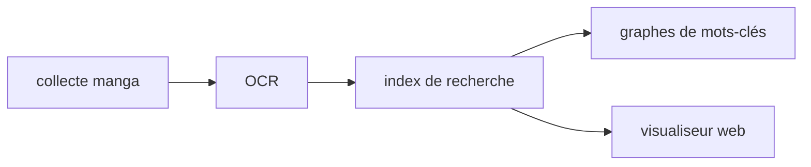

# project-violet/violet

> Boîte à outils personnelle pour collecter des mangas, faire de l'OCR, indexer et servir un visualiseur web.

## Le problème
Collecter du contenu manga, l'indexer et le consulter demande d'enchaîner plusieurs outils séparés.

## Ce que ça fait vraiment
Le README annonce la collecte de contenu manga, l'OCR, la construction d'index de recherche, l'analyse de graphes de mots-clés et un visualiseur web. Le déploiement Docker passe par un script `deploy.sh` et des fichiers de données à télécharger depuis Google Drive. Le reste est renvoyé à DOCKER.md, non fourni.

## Comment c'est branché

Schéma simplifié d'après la fiche, sans diagramme fourni.

## Essayer
```bash
curl -fsSL https://raw.githubusercontent.com/project-violet/violet/main/deploy.sh | VIOLET_DATA_ROOT=/srv/violet-data sh
```

## Coût et pièges
Gratuit, mais il faut récupérer les données sur Google Drive (service tiers). La commande exécute un script distant sans l'avoir lu : à vérifier avant de lancer. Aucune licence n'est déclarée.

## Ce que ce n'est pas
Ce n'est pas un outil documenté : le README fait quelques lignes, le détail est dans DOCKER.md. Sans licence, la réutilisation du code n'est pas autorisée. Le contenu collecté peut poser des questions de droits, non traitées.

## Alternatives
Aucune alternative nommée dans le README.

## Pour toi
À ignorer : outil personnel sans licence, hors du périmètre data / IA / MLOps, et très peu documenté.

