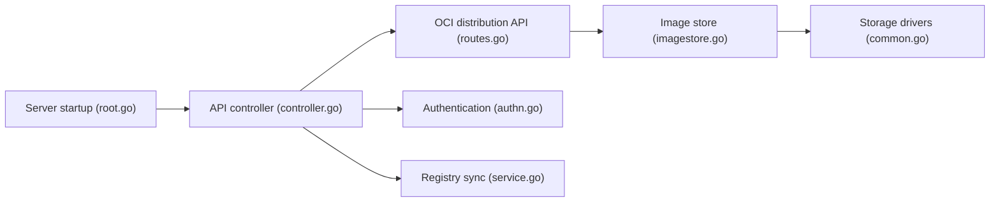

# project-zot/zot

> Vendor-neutral OCI image registry; minimal fiche, near-empty README.

## The problem
Not documented in the README: it is limited to a slogan and a link to zotregistry.dev.

## What it actually does
According to the architecture derived from the code: OCI registry server (distribution API), authentication, image storage with storage drivers, metadata, replication (sync), search and CVE scanning, retention, event extensions, plus CLI clients, a metrics exporter and a benchmark tool.

## How it is wired

## Trying it
No command documented in the README; see https://zotregistry.dev.

## Cost and gotchas
Not documented in the README.

## What it is not
Not installation documentation: the README says nothing about deployment. The "production-ready" label is the author's claim, not verified here.

## Alternatives
No alternative named in the README.

## For you
Worth watching: a lightweight OCI registry with CVE search is relevant in MLOps, but you need to read the external documentation to judge.
