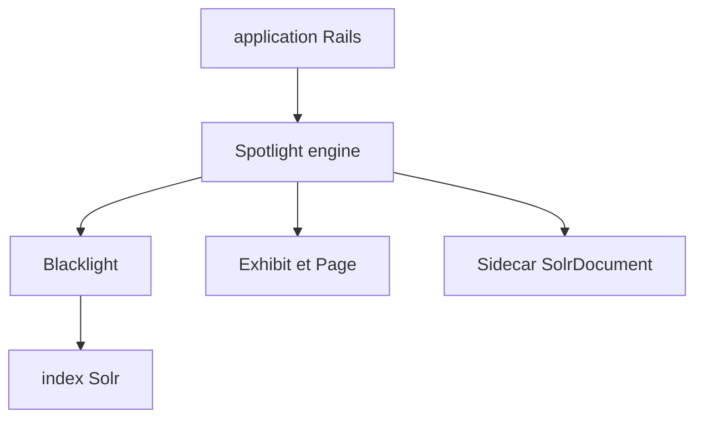

# projectblacklight/spotlight

> Rails engine for building digital collection exhibit sites, on top of Blacklight and Solr.

## The problem
Librarians and curators want to publish collection exhibits without developing a custom site.

## What it actually does
Provides exhibits, pages (Sir Trevor editor), custom fields, Solr sidecars and imported resources. It installs into a Rails application with Solr for the index and ImageMagick for images; a job-tracking cleanup task needs to be scheduled.

## How it is wired
Simplified diagram based on the fiche, no diagram provided.


## Trying it
```bash
SKIP_TRANSLATION=1 rails new app-name -m https://raw.githubusercontent.com/projectblacklight/spotlight/main/template.rb -a propshaft --css bootstrap
SKIP_TRANSLATION=1 rake db:migrate
solr_wrapper
bin/dev
```

## Cost and gotchas
Ruby 3.3+, Rails 7.1+, Java 11+ for Solr, ImageMagick. Mail must be configured. The catalog does not recognize the license.

## What it is not
Not a turnkey site: an extension to integrate into Rails.

## Alternatives
No alternative named.

## For you
Ignore: digital library tool in Ruby, outside data/AI.
