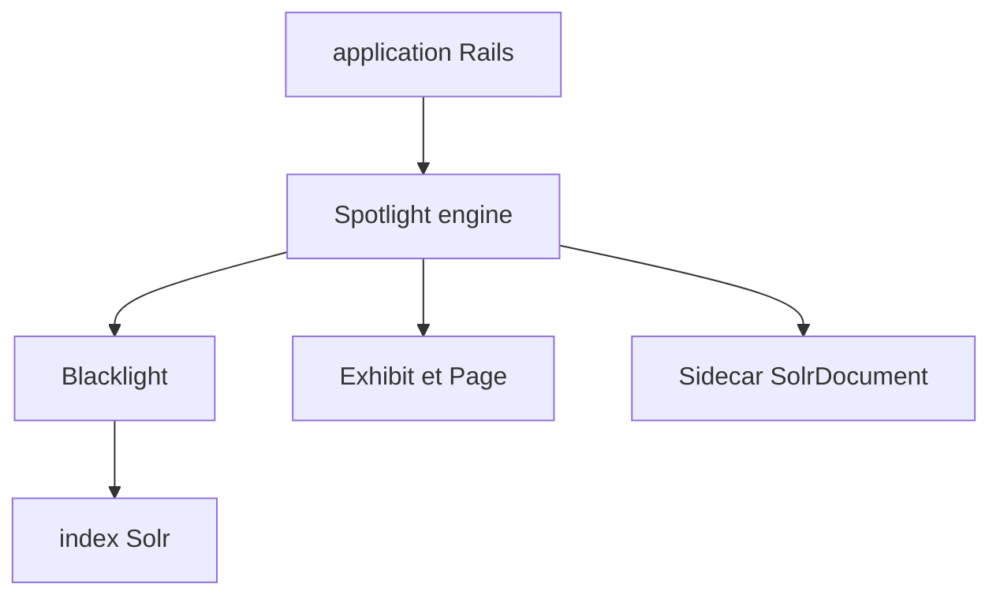

# projectblacklight/spotlight

> Moteur Rails pour bâtir des sites d'exposition de collections numériques, au-dessus de Blacklight et Solr.

## Le problème
Bibliothécaires et conservateurs veulent publier des expositions de collections sans développer un site sur mesure.

## Ce que ça fait vraiment
Fournit exhibits, pages (éditeur Sir Trevor), champs personnalisés, sidecars Solr et ressources importées. Il s'installe dans une application Rails avec Solr pour l'index, ImageMagick pour les images, tâche de nettoyage des suivis de jobs à planifier.

## Comment c'est branché
Schéma simplifié d'après la fiche, sans diagramme fourni.


## Essayer
```bash
SKIP_TRANSLATION=1 rails new app-name -m https://raw.githubusercontent.com/projectblacklight/spotlight/main/template.rb -a propshaft --css bootstrap
SKIP_TRANSLATION=1 rake db:migrate
solr_wrapper
bin/dev
```

## Coût et pièges
Ruby 3.3+, Rails 7.1+, Java 11+ pour Solr, ImageMagick. Courrier à configurer. Le catalogue ne reconnaît pas la licence.

## Ce que ce n'est pas
Pas un site clé en main : une extension à intégrer dans Rails.

## Alternatives
Aucune alternative nommée.

## Pour toi
À ignorer : outil de bibliothèques numériques en Ruby, hors data/IA.

