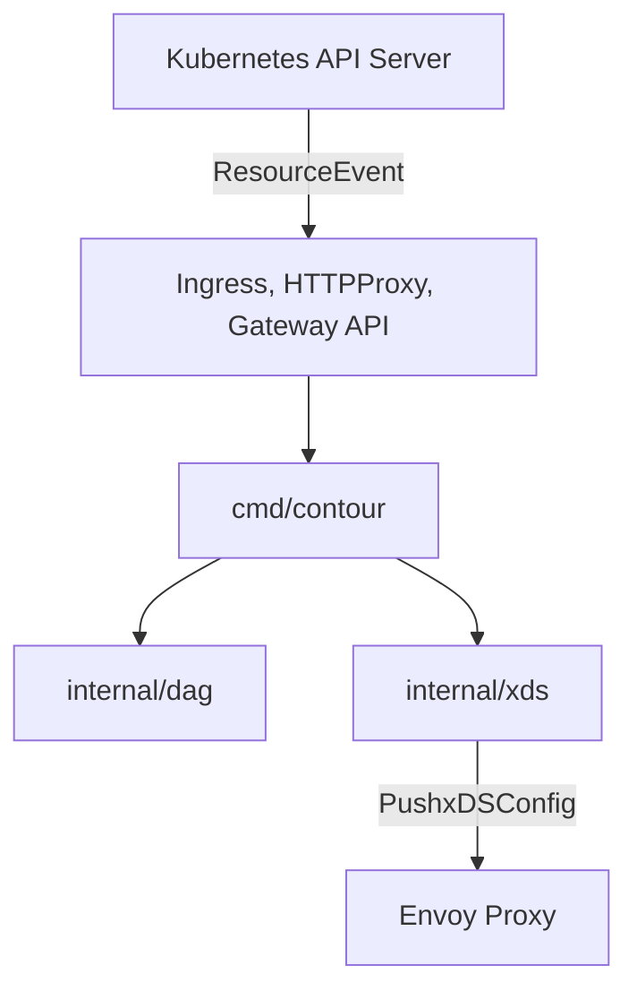

# projectcontour/contour

> Kubernetes ingress controller that drives the Envoy proxy, for platform teams.

## The problem
Exposing Kubernetes services requires a dynamically configured proxy, with richer routes than the standard Ingress API.

## What it actually does
Watches the Kubernetes API (Ingress, HTTPProxy CRD, Gateway API), rebuilds an internal routing graph and pushes the configuration to Envoy via xDS. Envoy does the proxying and load balancing work. The README advertises dynamic updates without reloads and a Cure53 security audit from December 2020.

## How it is wired

## Trying it
The README gives no command: it points to the "Getting Started" document. RBAC must be enabled on the cluster.

## Cost and gotchas
Free, but requires a Kubernetes cluster in a compatible version (compatibility matrix) with RBAC. You have to operate Envoy in addition to the controller.

## What it is not
Not a service mesh nor a full API gateway. The README describes three configuration APIs that you have to choose from.

## Alternatives
No alternative named in the README.

## For you
Worth watching: relevant if you expose models or APIs on Kubernetes, otherwise it is network infrastructure outside your core business.
