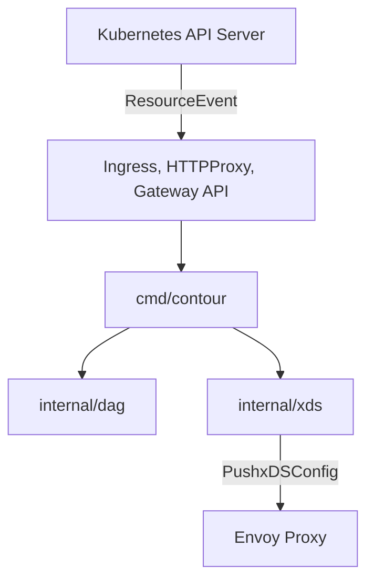

# projectcontour/contour

> Contrôleur d'ingress Kubernetes qui pilote le proxy Envoy, pour équipes plateforme.

## Le problème
Exposer des services Kubernetes demande un proxy configuré dynamiquement, avec des routes plus riches que l'API Ingress standard.

## Ce que ça fait vraiment
Surveille l'API Kubernetes (Ingress, CRD HTTPProxy, Gateway API), reconstruit un graphe de routage interne et pousse la configuration vers Envoy via xDS. Envoy fait le travail de proxy et d'équilibrage de charge. Le README annonce des mises à jour dynamiques sans rechargement et un audit de sécurité Cure53 de décembre 2020.

## Comment c'est branché

## Essayer
Le README ne donne pas de commande : il renvoie au document « Getting Started ». RBAC doit être activé sur le cluster.

## Coût et pièges
Gratuit, mais demande un cluster Kubernetes dans une version compatible (matrice de compatibilité) avec RBAC. Il faut exploiter Envoy en plus du contrôleur.

## Ce que ce n'est pas
Pas un service mesh ni un API gateway complet. Le README décrit trois API de configuration qu'il faut choisir.

## Alternatives
Aucune alternative nommée dans le README.

## Pour toi
À surveiller : pertinent si tu exposes des modèles ou API sur Kubernetes, sinon c'est de l'infrastructure réseau hors cœur de métier.

