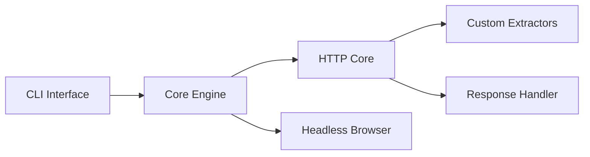

# projectdiscovery/httpx

> Command-line toolkit that probes HTTP servers and summarizes their responses.

## The problem
Check at scale which hosts respond over HTTP, with what status, title and technology.

## What it actually does
The CLI reads hosts, URLs or CIDRs, sends requests in parallel (50 threads, 150 requests/s by default) with automatic fallback from HTTPS to HTTP. It displays status, size, title, server, technologies, CDN, favicon hash, TLS. Filters and matchers sort the results; JSON, CSV or database output. Also usable as a Go library.

## How it is wired


## Trying it
```bash
go install -v github.com/projectdiscovery/httpx/cmd/httpx@latest
httpx -h
echo target.com | httpx -path '/robots.txt' -mc 200
```

## Cost and gotchas
Free; Go 1.25+ required for installation. The project announces breaking changes between versions. A ProjectDiscovery cloud dashboard is optional.

## What it is not
Not a vulnerability scanner: it probes and describes. The README advises against running it as a service (security risks). Probing third parties without authorization may be illegal.

## Alternatives
No alternative named in the README.

## For you
Worth watching: handy for checking the availability of your own endpoints or inference services, without being essential for a data/MLOps profile.
