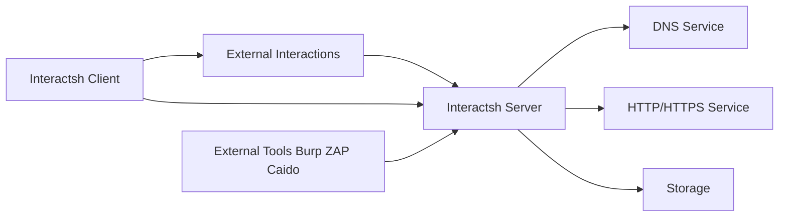

# projectdiscovery/interactsh

> Server and client for detecting out-of-band interactions (DNS, HTTP, SMTP, LDAP) during security testing.

## The problem
Some vulnerabilities (SSRF, blind injections) return nothing: you need a callback point to see whether the target issued a request.

## What it actually does
The client generates unique payloads and polls the server, which listens on DNS, HTTP(S), SMTP(S), LDAP, and optionally FTP, SMB, Responder. Exchanges are AES-encrypted, with no logging. Extensions exist for Burp, ZAP and Caido; Nuclei uses it.

## How it is wired


## Trying it
```bash
go install -v github.com/projectdiscovery/interactsh/cmd/interactsh-client@latest
interactsh-client
interactsh-client -v -o interactsh-logs.txt
docker run projectdiscovery/interactsh-client:latest
```

## Cost and gotchas
Public servers (oast.pro…) may change or go down. Self-hosting: a domain, a server running 24/7, open ports. Some options expose client code on your domain.

## What it is not
Not a scanner: it receives callbacks. Use only on authorized targets.

## Alternatives
- Nuclei: integrates Interactsh for automated OAST.

## For you
Ignore: a penetration-testing tool outside the data/AI scope, except for a security audit of a platform.
