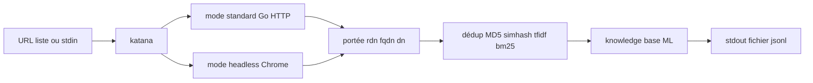

# projectdiscovery/katana

> Configurable web crawler, in standard or headless browser mode, built for automation.

## The problem
Collecting a site's URLs to feed a corpus or an audit requires handling scope, duplicates and JavaScript.
A naive crawler blows up on near-identical pages and misses everything rendered client-side.

## What it actually does
Two modes: standard, via the Go HTTP library, or headless, by hooking calls in the browser.
Parses JavaScript to extract entry points, and automatically fills in forms (experimental).
Filters similar pages by simhash, TF-IDF or BM25, with a per-cluster budget, in addition to MD5 deduplication.
Outputs to STDOUT, a file or JSONL, with configurable fields and storage of requests/responses.

## How it is wired


## Trying it
```bash
CGO_ENABLED=1 go install github.com/projectdiscovery/katana/cmd/katana@latest
katana -u https://tesla.com
echo https://tesla.com | katana
katana -u https://example.com -pcs -pcsm tfidf -pcst 0.85 -pcsn 2
```
As a container: `docker pull projectdiscovery/katana:latest` then `docker run projectdiscovery/katana:latest -u https://tesla.com`.

## Cost and gotchas
Go 1.26+ for installation, and Chrome installed for headless mode with `-system-chrome`.
The captcha options (`-csp capsolver`, `-csk`) involve a paid third-party service and a key at your expense.

## What it is not
Not a harmless tool: the README banner reminds you that you are responsible for what you crawl.
Not bounded by default: without `-d`, `-ct`, `-mdp` or a scope, a crawl may never end.
Not a content extractor: it discovers URLs and entry points, it does not build your corpus.

## Alternatives
`httpx` — cited upstream in the pipeline (`cat domains | httpx | katana`) to filter live hosts.

## For you
Excellent URL collector upstream of a RAG or a documentation crawl, provided you always set a scope.
