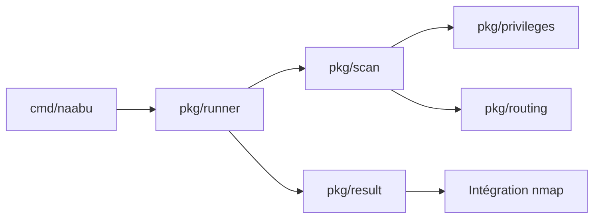

# projectdiscovery/naabu

> Go port scanner, as a command line or a library, to inventory your own hosts.

## The problem
Knowing which ports respond across a fleet of hosts, ranges or ASNs requires a fast tool that is scriptable and chainable with others.

## What it actually does
Naabu enumerates open ports with SYN, CONNECT or UDP probes, on varied inputs (host, list, CIDR, ASN, stdin). It handles IPv4/IPv6, host discovery (experimental), CDN/WAF exclusion, scan resumption and a passive mode via Shodan InternetDB. Service version detection reads the `nmap-service-probes` database from a local nmap installation. Output as text, JSON or CSV, and a Go library (`pkg/runner`) is provided.

## How it is wired


## Trying it
```bash
go install -v github.com/projectdiscovery/naabu/v2/cmd/naabu@latest
naabu -h
```
README prerequisites: `libpcap` (Linux: `libpcap-dev`, Mac: brew, Windows: Npcap). The README warns that the user is responsible for their actions.

## Cost and gotchas
Free. SYN scans require root rights, otherwise it falls back to CONNECT. A high rate increases false positives. The README assumes execution from a VPS; the ProjectDiscovery cloud option requires an API key. Only scan what you own or are authorized to test.

## What it is not
Not a vulnerability scanner: it lists ports. Service detection depends on a local nmap installation, not shipped for license reasons. Several options are marked experimental or deprecated.

## Alternatives
- nmap: cited by the README, more complete for service detection, less volume-oriented.
- httpx: cited downstream to identify HTTP servers on the ports found.

## For you
Keep an eye on it: occasionally useful for inventorying the exposure of your own data services (databases, model APIs), of no central interest for a data/AI profile.
