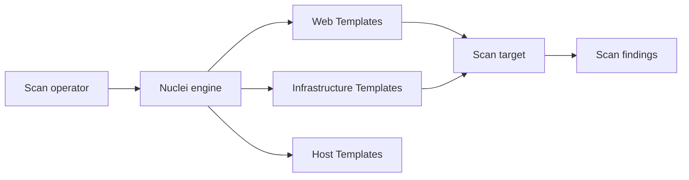

# projectdiscovery/nuclei-templates

> Community library of vulnerability detection templates, read by the Nuclei scan engine.

## The problem
Checking that an application or infrastructure does not expose known flaws requires describing each check in an executable form. Without a shared base, each team rewrites its own.

## What it actually does
This repository contains no engine: it stores templates (about 12,000 files) consumed by the separate Nuclei engine. They cover the HTTP, DNS, network, TLS, cloud, file and code protocols, plus workflows. The README announces 1,496 templates tied to vulnerabilities known to be exploited (CISA KEV, VulnCheck KEV) and relies on tags for filtering. Contributions arrive by pull request.

## How it is wired


## Trying it
```bash
nuclei -tags kev,vkev
```
Only command present in the README; installing the engine is covered by the documentation at https://nuclei.projectdiscovery.io.

## Cost and gotchas
Free, MIT license. The Nuclei engine is needed separately. A scan must only target systems you own or for which you have written authorization.

## What it is not
It is not a standalone scanner nor a remediation tool. A template that reports nothing does not prove the absence of a flaw. Quality varies by contributor.

## Alternatives
No alternative named in the README.

## For you
Worth watching: useful if your MLOps scope includes auditing exposed services (model APIs, admin panels), of no direct interest for purely data work.
