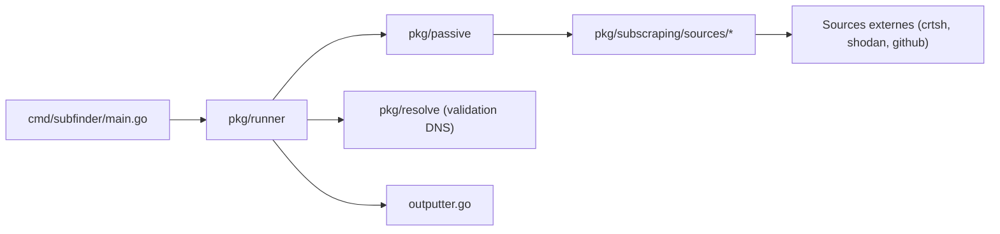

# projectdiscovery/subfinder

> Go tool for passive subdomain enumeration from online sources, for penetration testers.

## The problem
Listing a site's subdomains without querying its servers directly, by aggregating several public sources.

## What it actually does
Takes one or more domains, queries passive sources (crt.sh, Shodan, GitHub, VirusTotal, SecurityTrails…), normalizes and deduplicates, then can validate through DNS with wildcard elimination. Global or per-source rate options, filters, JSONL output, standard input/output. Also usable as a Go library.

## How it is wired


## Trying it
```bash
go install -v github.com/projectdiscovery/subfinder/v2/cmd/subfinder@latest
subfinder -h
subfinder -d example.com
subfinder -dL domains.txt -oJ -o result.json
```

## Cost and gotchas
Free, but many sources require API keys, to be put in the providers configuration file. Requires Go 1.26 for installation. Provider rate limits may restrict results.

## What it is not
Not a vulnerability scanner nor a full active reconnaissance tool: it only enumerates subdomains.

## Alternatives
The README names no alternative; it points to the ProjectDiscovery documentation.

## For you
Ignore: a security reconnaissance tool, outside the data/AI/MLOps profile; it would only serve to inventory your own exposed domains.
