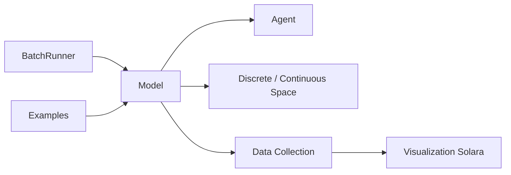

# projectmesa/mesa

> Python agent-based modeling library, with browser visualization and results analysis.

## The problem
Simulating populations of interacting agents (epidemics, markets, ecosystems) without starting over from a NetLogo or Java base.

## What it actually does
Modular components: model, agents, scheduling, spaces (discrete grids, networks, experimental continuous space), data collection, and a browser-based visualization interface (Solara, Matplotlib). Results come out as pandas structures for analysis. A library of example models (WolfSheep, Schelling, Sugarscape) serves as a reference. Mesa 3 is stable, Mesa 4 is in pre-release.

## How it is wired


## Trying it
```bash
pip install -U mesa
pip install -U "mesa[rec]"
docker compose up
```

## Cost and gotchas
Free. Since Mesa 3, not all dependencies are installed by default: choose extras (`network`, `viz`, `rec`). The diagram mentions a BatchRunner whose exact placement is not confirmed by the README.

## What it is not
Not a high-performance simulator: it is positioned as a Python alternative to NetLogo, Repast and MASON. Experimental modules are unstable.

## Alternatives
NetLogo, Repast, MASON (cited as the references it targets).

## For you
Adopt for multi-agent simulation in Python: a cited academic project (JOSS), community-maintained, well documented.
