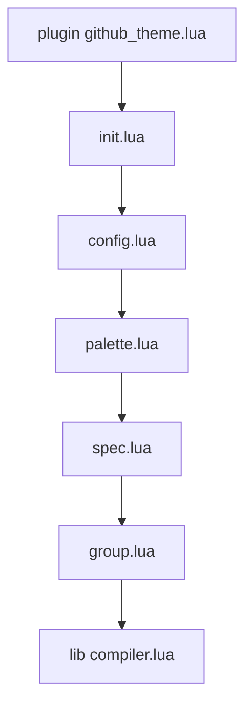

# projekt0n/github-nvim-theme

> Neovim theme reproducing GitHub's colors, for those who want an editor consistent with their browser.

## The problem
Neovim has no faithful GitHub theme, with colorblind variants, Treesitter and LSP support.

## What it actually does
Provides twelve color schemes (dark, light, dimmed, high contrast, colorblind) and several plugin modules. Palettes, specs and highlight groups can be overridden. The result is compiled into a cache to speed up startup, with the command :GithubThemeCompile. A lualine theme is included.

## How it is wired


## Trying it
```lua
require('github-theme').setup({})
vim.cmd('colorscheme github_dark')
```

## Cost and gotchas
Free. Neovim 0.8 or later and 24-bit colors. After a config change, run :GithubThemeCompile. Last push at the end of 2024: not very active.

## What it is not
Not a theme for VS Code or a terminal: those were moved to github-theme-contrib.

## Alternatives
nightfox.nvim, which inspired the code overhaul; github-theme-contrib for other editors.

## For you
Ignore unless you use Neovim and like the GitHub style: visual comfort, no effect on your work.
