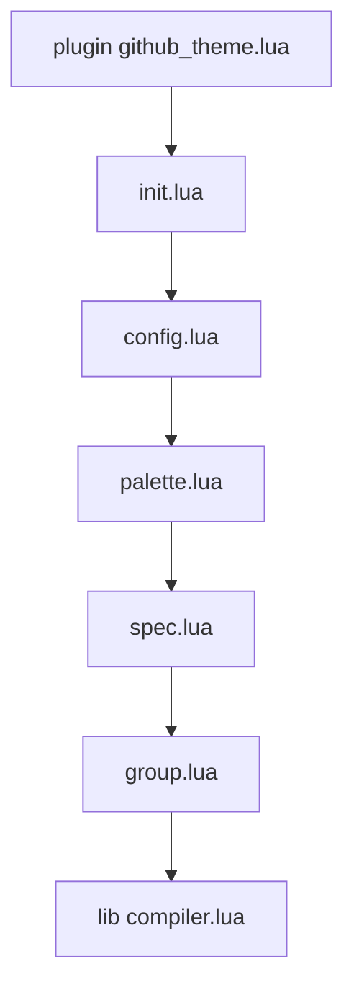

# projekt0n/github-nvim-theme

> Thème Neovim reprenant les couleurs GitHub, pour qui veut un éditeur cohérent avec son navigateur.

## Le problème
Neovim n'a pas de thème fidèle à GitHub, avec variantes daltoniens, Treesitter et LSP.

## Ce que ça fait vraiment
Fournit douze jeux de couleurs (sombre, clair, atténué, contraste élevé, daltoniens) et plusieurs modules de plugins. Palettes, spécifications et groupes de surbrillance sont surchargeables. Le résultat est compilé en cache pour accélérer le démarrage, avec la commande :GithubThemeCompile. Un thème lualine est inclus.

## Comment c'est branché


## Essayer
```lua
require('github-theme').setup({})
vim.cmd('colorscheme github_dark')
```

## Coût et pièges
Gratuit. Neovim 0.8 ou plus et couleurs 24 bits. Après un changement de config, lancer :GithubThemeCompile. Dernier push fin 2024 : peu actif.

## Ce que ce n'est pas
Pas un thème pour VS Code ni pour un terminal : ceux-ci ont été déplacés vers github-theme-contrib.

## Alternatives
nightfox.nvim, qui a inspiré la refonte du code ; github-theme-contrib pour les autres éditeurs.

## Pour toi
À ignorer sauf si tu es sous Neovim et aimes le style GitHub : confort visuel, sans effet sur ton travail.

