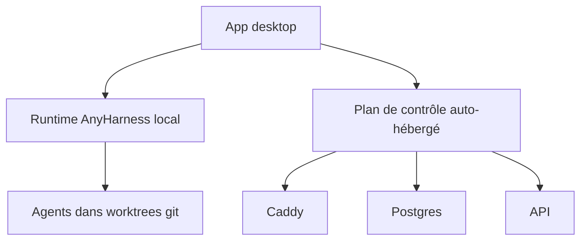

# proliferate-ai/proliferate

> Open workspace for running several coding agents in parallel, each in its own git worktree.

## The problem
Running several coding agents at the same time causes collisions between branches, terminals and review state.

## What it actually does
Desktop application that isolates each task in a git worktree with its own terminal, conversation and review state. It drives Claude Code, Codex, OpenCode, Cursor, Grok. It handles sub-agents, integrations (MCP, skills, Computer Use) and recurring workflows. The control plane can be self-hosted.

## How it is wired
Simplified diagram based on the note, no diagram provided.



## Trying it
```bash
make install
make dev-local
# plan de contrôle complet
make server-install
make setup PROFILE=main
make build
make run PROFILE=main
```

## Cost and gotchas
The connected agents consume your own keys or subscriptions. From source: Rust, Node.js 22+, pnpm; full development adds Python 3.12+, uv and Docker.

## What it is not
It is not a coding agent itself: it orchestrates those from other vendors. AGPL-3.0 license: obligations if you host it for third parties.

## Alternatives
No alternative named in the README.

## For you
Worth watching: worktree isolation answers a real need if you run several agents, but the project is six months old and has 103 open issues.
