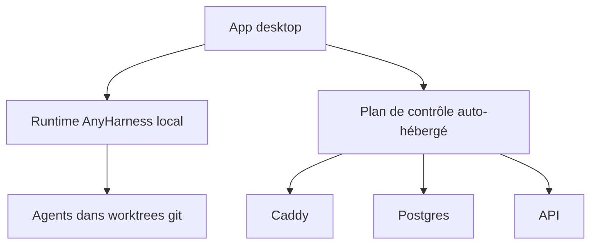

# proliferate-ai/proliferate

> Espace de travail libre pour lancer plusieurs agents de code en parallèle, chacun dans son worktree git.

## Le problème
Faire tourner plusieurs agents de code en même temps provoque des collisions de branches, de terminaux et d'état de revue.

## Ce que ça fait vraiment
Application bureau qui isole chaque tâche dans un worktree git avec son terminal, sa conversation et son état de revue. Elle pilote Claude Code, Codex, OpenCode, Cursor, Grok. Elle gère sous-agents, intégrations (MCP, skills, Computer Use) et workflows récurrents. Le plan de contrôle est auto-hébergeable.

## Comment c'est branché
Schéma simplifié d'après la fiche, sans diagramme fourni.



## Essayer
```bash
make install
make dev-local
# plan de contrôle complet
make server-install
make setup PROFILE=main
make build
make run PROFILE=main
```

## Coût et pièges
Les agents branchés consomment tes propres clés ou abonnements. Depuis les sources : Rust, Node.js 22+, pnpm ; le développement complet ajoute Python 3.12+, uv et Docker.

## Ce que ce n'est pas
Ce n'est pas un agent de code lui-même : il orchestre ceux d'autres éditeurs. Licence AGPL-3.0 : obligations si tu l'héberges pour des tiers.

## Alternatives
Aucune alternative nommée dans le README.

## Pour toi
À surveiller : l'isolation par worktree répond à un vrai besoin si tu lances plusieurs agents, mais le projet a six mois et 103 issues ouvertes.

