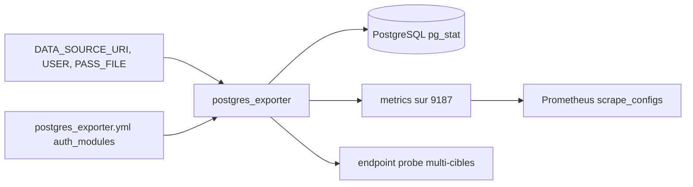

# prometheus-community/postgres_exporter

> Prometheus exporter that exposes the metrics of a PostgreSQL server.

## The problem
PostgreSQL statistics live in `pg_stat*` views that no monitoring tool reads on its own.
Without a translation layer, there are no alerts and no charts.

## What it actually does
Exposes metrics on `:9187/metrics`, ready to be scraped by Prometheus.
About twenty collectors that can be enabled or disabled: `locks`, `replication`, `stat_statements`, `wal`…
The connection is described with `DATA_SOURCE_NAME` or `DATA_SOURCE_URI` plus a user and password,
with `_FILE` variants to read a secret from a file instead of an environment variable.
PostgreSQL versions tested in continuous integration: 13 to 18.

## How it is wired


## Trying it
```bash
docker run \
  --net=host \
  -e DATA_SOURCE_URI="localhost:5432/postgres?sslmode=disable" \
  -e DATA_SOURCE_USER=postgres \
  -e DATA_SOURCE_PASS=password \
  quay.io/prometheuscommunity/postgres-exporter
curl "http://localhost:9187/metrics"
```

## Cost and gotchas
Free. Avoid passing the password as an environment variable: prefer a mounted `DATA_SOURCE_PASS_FILE`.
The container process runs as uid/gid 65534, which matters for permissions on mounted files.

## What it is not
Not a dashboard: it exposes metrics, and Grafana or something else displays them.
Not an application monitor: it reads the system views, not your business queries.
Several historical options (`auto-discover-databases`, `extend.query-path`, `constantLabels`) are deprecated.

## Alternatives
`sql_exporter`, recommended for generic database monitoring through SQL queries.

## For you
The standard choice if you have a PostgreSQL to monitor; plan for the `pg_monitor` role to avoid using the superuser.
