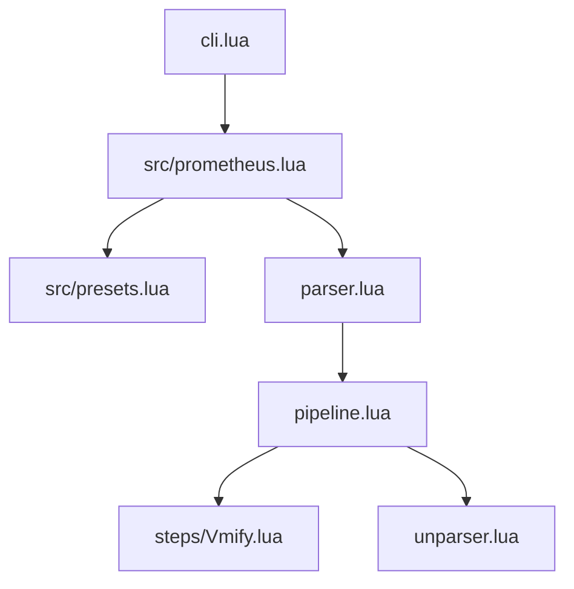

# prometheus-lua/Prometheus

> Lua code obfuscator written in pure Lua, to protect Lua 5.1 or LuaU scripts.

## The problem
A distributed Lua script is easy to read and reverse-engineer.

## What it actually does
Parses the source into a syntax tree, applies steps (virtualization into a register machine with Vmify, control-flow flattening with Cff, string encryption with EncryptStrings), then rewrites the code. Tuning presets.

## How it is wired


## Trying it
```bash
curl -fsSL https://raw.githubusercontent.com/prometheus-lua/Prometheus/master/install.sh | sh
prometheus-lua --version
prometheus-lua --preset Medium ./your_file.lua
```

## Cost and gotchas
The binary embeds a Lua runtime. LuaU support is partial. Read the install script before piping it into a shell. License not identified.

## What it is not
Not encryption: obfuscation slows down reading but does not protect a secret.

## Alternatives
- javascript-obfuscator (the inspiration, for JavaScript).

## For you
Ignore: Lua only; no obvious use in data or MLOps.
