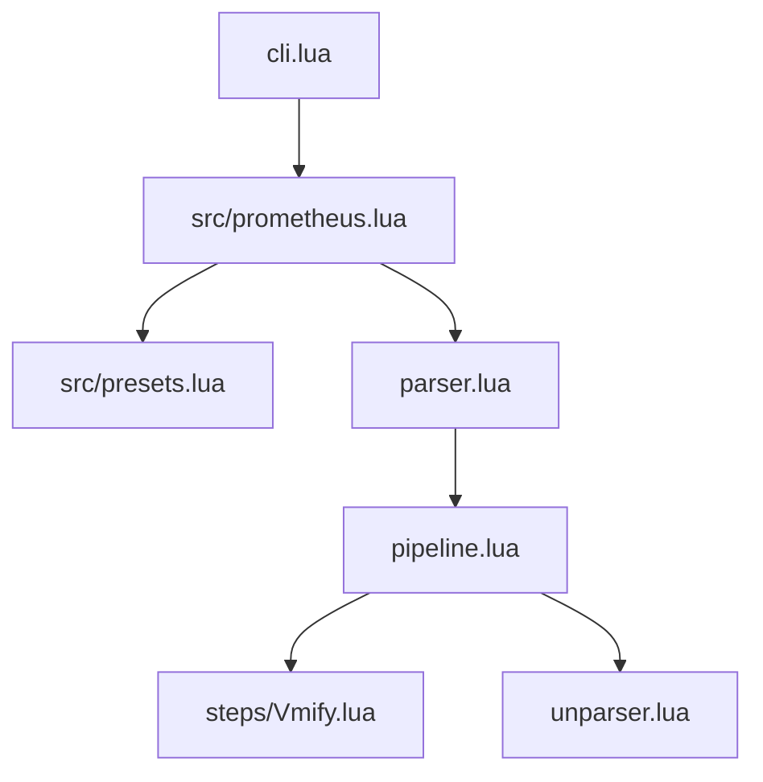

# prometheus-lua/Prometheus

> Obfuscateur de code Lua en Lua pur, pour protéger des scripts Lua 5.1 ou LuaU.

## Le problème
Un script Lua distribué se lit et se rétro-ingénie facilement.

## Ce que ça fait vraiment
Parse le source en arbre syntaxique, applique des étapes (virtualisation en machine à registres Vmify, aplatissement du flux Cff, chiffrement de chaînes EncryptStrings), puis réécrit le code. Presets de réglage.

## Comment c'est branché


## Essayer
```bash
curl -fsSL https://raw.githubusercontent.com/prometheus-lua/Prometheus/master/install.sh | sh
prometheus-lua --version
prometheus-lua --preset Medium ./your_file.lua
```

## Coût et pièges
Le binaire embarque un runtime Lua. Le support LuaU est partiel. Le script d'installation est à lire avant de l'exécuter en pipe. Licence non identifiée.

## Ce que ce n'est pas
Pas un chiffrement : l'obfuscation retarde la lecture mais ne protège pas un secret.

## Alternatives
- javascript-obfuscator (l'inspirateur, pour JavaScript).

## Pour toi
À ignorer : Lua seulement ; aucun usage évident en data ou MLOps.

