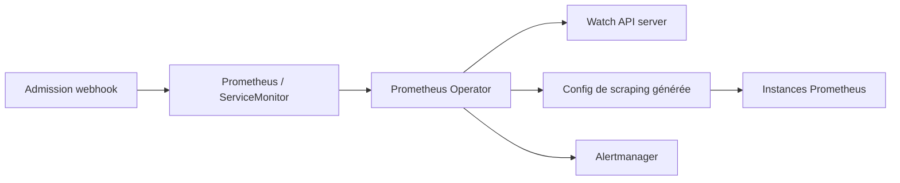

# prometheus-operator/prometheus-operator

> Deployment and configuration of Prometheus and Alertmanager through native Kubernetes resources.

## The problem
Configuring Prometheus in Kubernetes means hand-writing a dedicated configuration language, and redoing that work every time services or targets change.

## What it actually does
Introduces CRDs — `Prometheus`, `PrometheusAgent`, `Alertmanager`, `ThanosRuler`, `ServiceMonitor`, `PodMonitor`, `Probe`, `ScrapeConfig`, `PrometheusRule`, `AlertmanagerConfig` — and watches the API server to keep deployments in line with these objects. Scrape targets are declared with Kubernetes label selectors, without writing Prometheus configuration. An admission webhook validates `PrometheusRule` objects before they are applied, to prevent an invalid rule from breaking the deployed instance.

## How it is wired


## Trying it
```sh
kubectl create -f bundle.yaml
NAMESPACE=my_namespace kustomize edit set namespace $NAMESPACE && kubectl create -k .
make
scripts/run-external.sh <kubectl cluster name>
```

## Cost and gotchas
Free. Kubernetes 1.16 minimum. The `bundle.yaml` deploys into `default`: changing namespace requires adapting the ClusterRoleBinding. Uninstallation is manual and multi-step — delete the resources per namespace, then the operator, then the services and the CRDs.

## What it is not
Not a complete monitoring stack: the quickstart only provides the operator — kube-prometheus or the `kube-prometheus-stack` chart bring exporters, dashboards and alerting rules. The `v1beta1` and `v1alpha1` APIs are unstable, `v1alpha1` discouraged outside tolerant environments.

## Alternatives
- **kube-prometheus**: example configurations for a complete monitoring stack.
- **prometheus-community/kube-prometheus-stack**: same scope via Helm, community-maintained.

## For you
The expected foundation as soon as you need to measure ML services in Kubernetes.
