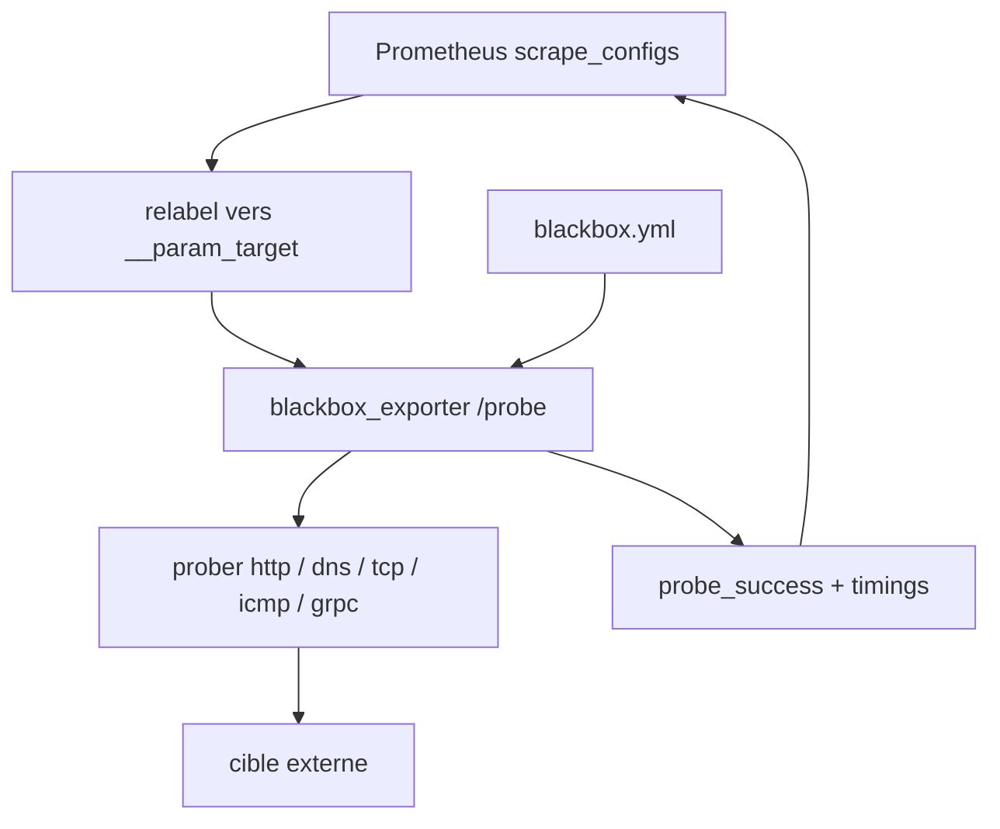

# prometheus/blackbox_exporter

> Prometheus probe that tests endpoints over HTTP, DNS, TCP, ICMP and gRPC.

## The problem
Prometheus can scrape whatever exposes metrics; it cannot tell whether a site responds, whether a certificate is holding up or whether a DNS name resolves.
Without an external probe, an outage is noticed on the user side.

## What it actually does
A call to `/probe?target=...&module=...` triggers a probe and returns the test's metrics, including `probe_success` and the timings of each step.
`debug=true` returns the probe's details; the ratio `probe_duration_seconds / probe_timeout_seconds` tells how much margin is left before the timeout.
Two independent structured logs: `--log.level` for the application, `--log.prober` for the probes themselves, which avoids drowning one in the other.
The configuration reloads via `SIGHUP`, via a POST to `/-/reload`, or automatically with `--config.enable-auto-reload` (adjustable interval, 30 s by default).

## How it is wired


## Trying it
```bash
docker run --rm \
-p 9115/tcp \
--name blackbox_exporter \
-v $(pwd):/config \
quay.io/prometheus/blackbox-exporter:latest --config.file=/config/blackbox.yml
curl -sL "http://localhost:9115/probe?target=prometheus.io&module=http_2xx&debug=true"
```

## Cost and gotchas
Free. The ICMP probe requires privileges: Administrator on Windows, `CAP_NET_RAW` or `net.ipv4.ping_group_range` on Linux, root on BSD.
The probe timeout is derived from Prometheus's `scrape_timeout`; with nothing set, 120 s — and TLS/basic auth via `--web.config.file` apply to all endpoints, `/metrics` included.

## What it is not
It is not an alerting system or a dashboard: it produces metrics, Prometheus does the rest.
Nor is it multi-target on its own — the "multi-target exporter" pattern requires relabeling on the Prometheus side, which the README points to a dedicated guide for.

## Alternatives
No alternative is named in the README.

## For you
The standard building block for monitoring your inference endpoints from the outside; nothing to reinvent.
