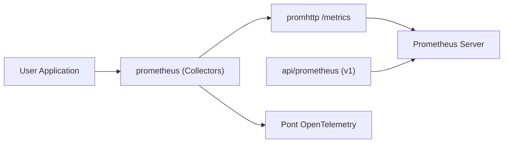

# prometheus/client_golang

> Official Go library to instrument applications with Prometheus and query its HTTP API.

## The problem
Exposing metrics from a Go application in a format Prometheus can scrape.

## What it actually does
Two parts: the `prometheus` package (counters, gauges, histograms, Go and process collectors, `promhttp`) and a client for the Prometheus HTTP API (`api/prometheus`), still experimental. An OpenTelemetry bridge makes it possible to export these metrics as OTLP (push). Follows semantic versioning; the API client is excluded from it.

## How it is wired

## Trying it
No documented command: the README points to the instrumentation guide on the Prometheus site and the `examples/` folder.

## Cost and gotchas
Free. Supports the last two major Go versions. The API client may break without a major version change.

## What it is not
Not a Prometheus server nor a dashboard.

## Alternatives
None named in the README (OpenTelemetry bridge cited).

## For you
Watch: relevant only for Go services to monitor; in Python, use the Prometheus Python client.
