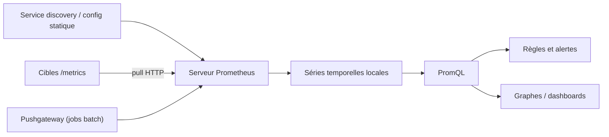

# prometheus/prometheus

> Metrics-based monitoring system, a project of the Cloud Native Computing Foundation.

## The problem
Without centralized metric collection, an incident is diagnosed blindly, and there are no alert thresholds.

## What it actually does
Collect metrics on targets at regular intervals using the HTTP "pull" method, evaluate rule expressions, display the results, and trigger alerts. A multidimensional data model (metric name + key/value pairs) is queried using PromQL. Independent nodes, without dependency on a distributed storage system. Targets come from service discovery or static configuration; batch jobs are pushed through an intermediate gateway. Hierarchical and horizontal federation.

## How it is wired


## Trying it
```bash
docker run --name prometheus -d -p 127.0.0.1:9090:9090 prom/prometheus
make build
./prometheus --config.file=your_config.yml
```

## Cost and gotchas
Free. Requires Go compiler (version of `go.mod`), NodeJS and npm ≥ 10. The `go install` command must be run from the root of the repository to find the web assets, and does not include the React UI without using `make assets`.

## What it is not
`prometheus/prometheus` is **not** designed as a Go library: errors only appear when used in this way. The Prometheus version numbers do not correspond to Go tags (v3.y.z ↔ v0.3yy.z). The Remote Write protobuf published on buf.build is experimental.

## Alternatives
- prometheus/common and prometheus/client-golang: These repositories are designed as reusable libraries.

## For you
To adopt: the established standard for MLOps, and the source of SLOs (Service Level Objectives) for a model service.
