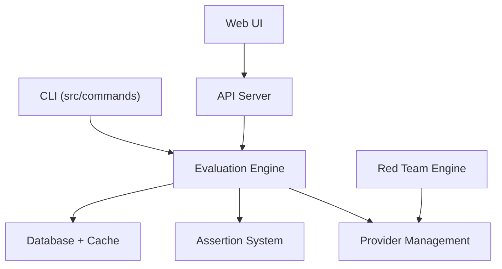

# promptfoo/promptfoo

> CLI and library for evaluating LLM applications and red-teaming them.

## The problem
Choosing prompts and models by gut feeling, without reproducible tests or security checks.

## What it actually does
Automated evaluations, side-by-side model comparison (OpenAI, Anthropic, Azure, Bedrock, Ollama), vulnerability scanning, CI/CD checks, PR review for LLM risks. Evaluations run locally according to the README. The project is now part of OpenAI, and remains MIT.

## How it is wired


## Trying it
```bash
npm install -g promptfoo
promptfoo init --example getting-started
export OPENAI_API_KEY=sk-abc123
promptfoo eval
promptfoo view
```

## Cost and gotchas
Calls to LLM providers are billed by them. A telemetry module exists in the architecture; its setting is not documented in the README.

## What it is not
Not a model or an agent framework: a test bench. Does not replace your own business metrics.

## Alternatives
None named in the README.

## For you
Adopt: a direct tool to industrialize prompt and model evaluation in MLOps.
