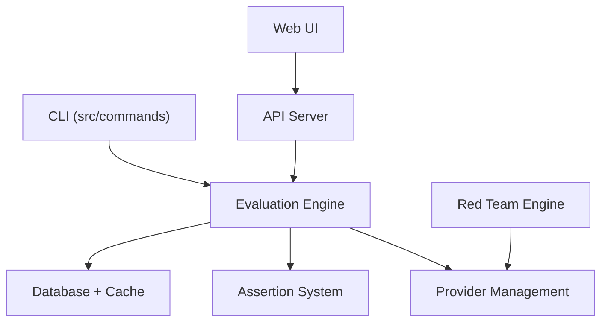

# promptfoo/promptfoo

> CLI et bibliothèque pour évaluer des applications LLM et les soumettre à du red teaming.

## Le problème
Choisir prompts et modèles à l'intuition, sans tests reproductibles ni contrôle de sécurité.

## Ce que ça fait vraiment
Évaluations automatisées, comparaison de modèles côte à côte (OpenAI, Anthropic, Azure, Bedrock, Ollama), scan de vulnérabilités, vérifications en CI/CD, revue de PR pour risques LLM. Les évaluations tournent en local selon le README. Le projet fait désormais partie d'OpenAI, reste MIT.

## Comment c'est branché


## Essayer
```bash
npm install -g promptfoo
promptfoo init --example getting-started
export OPENAI_API_KEY=sk-abc123
promptfoo eval
promptfoo view
```

## Coût et pièges
Les appels aux fournisseurs LLM sont facturés par eux. Un module de télémétrie existe dans l'architecture ; réglage non documenté dans le README.

## Ce que ce n'est pas
Pas un modèle ni un framework d'agents : un banc d'essai. Ne remplace pas des métriques métier propres.

## Alternatives
Aucune nommée dans le README.

## Pour toi
À adopter : outil direct pour industrialiser l'évaluation de prompts et de modèles en MLOps.

