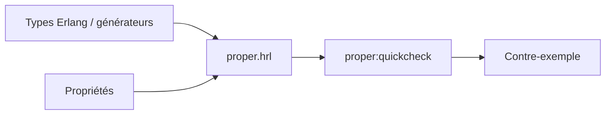

# proper-testing/proper

> Property-based testing tool for Erlang, inspired by QuickCheck, for Erlang developers.

## The problem
Writing test cases by hand is slow and you do not know whether the suite covers all aspects of the program.

## What it actually does
You describe the shape of valid inputs and the expected properties; PropEr generates increasingly complex random inputs and checks the properties. It targets pure functions and provides two modules for stateful code. It reuses Erlang types and can test functions from their specs.

## How it is wired


## Trying it
```bash
git clone git@github.com:proper-testing/proper.git
make
export ERL_LIBS=/full/path/to/proper
# dans les sources : -include_lib("proper/include/proper.hrl").
# puis : proper:quickcheck(your_module:some_property()).
```

## Cost and gotchas
Free; `brew install proper` is also mentioned. The `?LET` macro conflicts with EUnit, and output is hidden by EUnit (option `{to_file, user}`).

## What it is not
It is not a faithful copy of QuviQ QuickCheck: the README lists incompatibilities. It does not target languages other than Erlang.

## Alternatives
QuviQ QuickCheck, which it is inspired by (commercial tool, not detailed in the README).

## For you
Ignore: relevant only if you write Erlang; the principle remains useful, but with no direct link to Python/MLOps.
