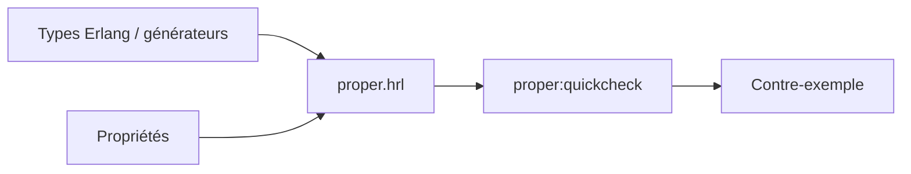

# proper-testing/proper

> Outil de test par propriétés pour Erlang, inspiré de QuickCheck, pour développeurs Erlang.

## Le problème
Écrire à la main les cas de test est long et on ignore si la suite couvre tous les aspects du programme.

## Ce que ça fait vraiment
Vous décrivez la forme des entrées valides et des propriétés attendues ; PropEr génère des entrées aléatoires de plus en plus complexes et vérifie les propriétés. Il cible les fonctions pures et fournit deux modules pour le code à état. Il réutilise les types Erlang et peut tester des fonctions d'après leurs specs.

## Comment c'est branché


## Essayer
```bash
git clone git@github.com:proper-testing/proper.git
make
export ERL_LIBS=/full/path/to/proper
# dans les sources : -include_lib("proper/include/proper.hrl").
# puis : proper:quickcheck(your_module:some_property()).
```

## Coût et pièges
Gratuit ; `brew install proper` est aussi cité. Conflit de la macro `?LET` avec EUnit, et sortie masquée par EUnit (option `{to_file, user}`).

## Ce que ce n'est pas
Ce n'est pas une copie fidèle de QuviQ QuickCheck : le README liste des incompatibilités. Il ne vise pas d'autres langages qu'Erlang.

## Alternatives
QuviQ QuickCheck, dont il est inspiré (outil commercial, non détaillé dans le README).

## Pour toi
Ignorer : pertinent seulement si tu écris de l'Erlang ; le principe reste utile, mais sans lien direct avec Python/MLOps.

