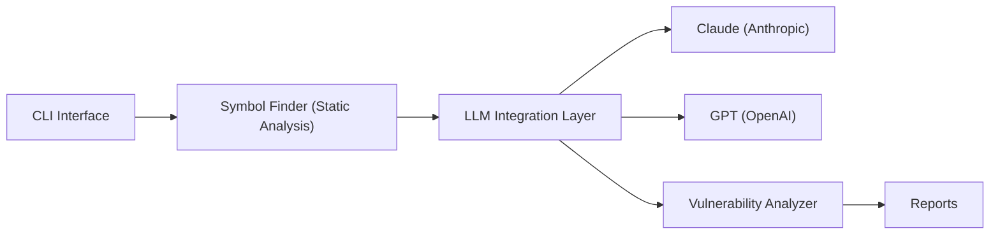

# protectai/vulnhuntr

> Tool that looks for remotely exploitable vulnerabilities in Python code, combining an LLM and static analysis.

## The problem
Classic scanners handle poorly multi-step vulnerabilities that cross several files, from user input to server output.

## What it actually does
The LLM summarizes the README, analyzes a file, then receives a prompt specific to each vulnerability class (LFI, AFO, RCE, XSS, SQLI, SSRF, IDOR) and requests the functions and classes it needs, resolved by Jedi. It produces reasoning, a proof of concept and a confidence score (7 to investigate, 8+ likely). Python 3.10 only.

## How it is wired


## Trying it
```bash
pipx install git+https://github.com/protectai/vulnhuntr.git --python python3.10
export ANTHROPIC_API_KEY="sk-1234"
vulnhuntr -r /path/to/target/repo/
```

## Cost and gotchas
The README warns that it can run up your bill: it fills the context window. Set spending limits. Python 3.10 strictly required. Last push in February 2025.

## What it is not
Not an exhaustive scanner: seven vulnerability classes, Python only. Ollama is marked experimental, open models structure their output poorly.

## Alternatives
No alternative named in the README.

## For you
Worth watching: useful for auditing Python AI app code, but inactive since 2025 and token-hungry; test on a single file first.
