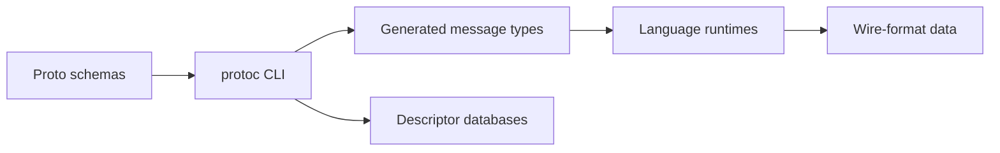

# protocolbuffers/protobuf

> Google's structured-data serialization format, with a compiler and per-language libraries.

## The problem
Exchanging data between services written in different languages requires a compact, typed and evolvable format.

## What it actually does
You write `.proto` schemas; the `protoc` compiler generates message types for each language. Runtimes serialize and read the binary format. Reflection and descriptor databases make it possible to inspect schemas. Languages: C++, Java, Python, Objective-C, C#, Ruby, Go, PHP, Dart, JavaScript.

## How it is wired


## Trying it
```
bazel_dep(name = "protobuf", version = <VERSION>)
```
The `protoc` binary can be downloaded from the releases page; tutorial at https://protobuf.dev/getting-started.

## Cost and gotchas
Free. The README advises against working on the main branch: breaking changes and poorly tested behaviors; pin a release commit.

## What it is not
Not a network protocol or an RPC: only a data format and its compiler. The license is not identified by GitHub.

## Alternatives
No alternative named in the README.

## For you
Adopt: the basis of many service and model exchanges (gRPC), to be pinned to a released version.
