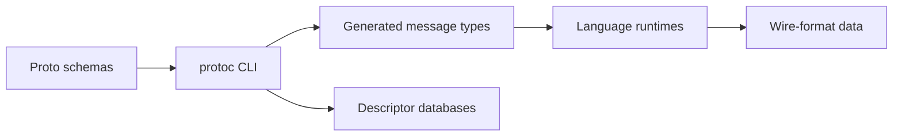

# protocolbuffers/protobuf

> Format de sérialisation de données structurées de Google, avec compilateur et bibliothèques par langage.

## Le problème
Échanger des données entre services écrits dans des langages différents demande un format compact, typé et évolutif.

## Ce que ça fait vraiment
On écrit des schémas `.proto` ; le compilateur `protoc` génère des types de messages pour chaque langage. Les runtimes sérialisent et lisent le format binaire. Réflexion et bases de descripteurs permettent d'inspecter les schémas. Langages : C++, Java, Python, Objective-C, C#, Ruby, Go, PHP, Dart, JavaScript.

## Comment c'est branché


## Essayer
```
bazel_dep(name = "protobuf", version = <VERSION>)
```
Le binaire `protoc` se télécharge depuis la page des versions ; tutoriel sur https://protobuf.dev/getting-started.

## Coût et pièges
Gratuit. Le README déconseille de travailler sur la branche principale : changements incompatibles et comportements peu testés ; épingler un commit de version.

## Ce que ce n'est pas
Pas un protocole réseau ni un RPC : seulement un format de données et son compilateur. La licence n'est pas identifiée par GitHub.

## Alternatives
Aucune alternative nommée dans le README.

## Pour toi
À adopter : base de nombreux échanges de services et de modèles (gRPC), à épingler sur une version publiée.

