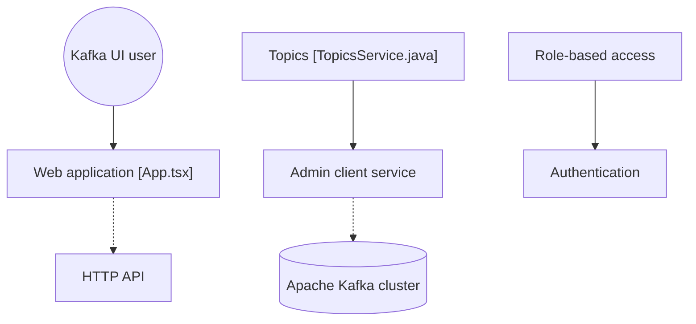

# provectus/kafka-ui

> Web interface to monitor and administer Apache Kafka clusters, aimed at teams that operate Kafka.

## The problem
Inspecting Kafka brokers, topics, consumer groups and messages from the command line is slow and hard to read.

## What it actually does
A web application that manages several clusters: brokers, topics, partitions, consumer group lag, browsing and producing messages (JSON, text, Avro), schema registry, Kafka Connect, ksqlDB. It adds OAuth authentication, role-based access control and data masking.

## How it is wired


## Trying it
```bash
docker run -it -p 8080:8080 -e DYNAMIC_CONFIG_ENABLED=true provectuslabs/kafka-ui
# puis http://localhost:8080
```

## Cost and gotchas
Free, but you need a Kafka cluster to query. Last push in July 2024 and 352 open issues: maintenance to be verified.

## What it is not
Not a full monitoring tool: it shows state and acts, it replaces neither Prometheus nor an alerting system.

## Alternatives
No alternative named in the README.

## For you
Keep an eye on it: useful if your data pipelines go through Kafka, but the repository has had no push since July 2024.
